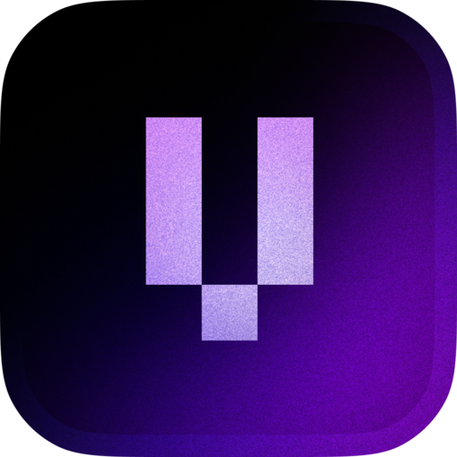

<div align="center">


<h1><b>Vleer</b></h1>

A fast, native, open-source music player that keeps your music library clean.

<a href="https://docs.vleer.app">Docs</a> · <a href="https://discord.gg/invites/PEX37vvWyU">Discord</a>

</div>
<br>


## Features

- Native and fast, written in Rust with a GPU-rendered UI
- Song and artist matching through [OpenMusicMetadata](https://docs.vleer.app) for clean names and artwork
- No account required, telemetry covers only OS, version, and song count and is public
- Fixes messy tags, merges duplicate artists, and fills in missing years and artwork without modifying your files
- Songs identified by audio, so renaming or moving files doesn't break favorites, playlists, or history
- Fuzzy search across songs, artists, albums, and playlists
- Embedded lyrics first, then synced lyrics from LRCLIB
- Fast scanner that indexes about 60,000 songs in 10 seconds
- FLAC, MP3, OGG Vorbis, Opus, AAC, and WAV
- Loudness normalization using ReplayGain tags
- Parametric equalizer
- Last.fm scrobbling
- Discord Rich Presence
- Live SQLite library that watches your folders
- Spectrum visualizer
- Self-updating, with stable and nightly channels

## Roadmap

Not final, and nothing here is shipped yet.

- [ ] Navidrome, Subsonic, and OpenSubsonic support
- [ ] Soulseek integration
- [ ] Recommendations based on your listening habits

## Installation

Stable is what you want for everyday use. Nightly builds are made automatically from the latest changes and may be less polished. Every version is listed with its release notes on the [stable](https://vleer.app/releases/stable) and [nightly](https://vleer.app/releases/nightly) release pages, and you can also grab builds from [vleer.app/download](https://vleer.app/download).

<h3>
  <picture>
    <source media="(prefers-color-scheme: dark)" srcset="./assets/readme/microsoft_dark.svg">
    <source media="(prefers-color-scheme: light)" srcset="./assets/readme/microsoft_light.svg">
    
  </picture>
  <span>Windows</span>
</h3>

|       | Stable                                                                | Nightly                                                                            |
| ----- | --------------------------------------------------------------------- | ---------------------------------------------------------------------------------- |
| x64   | [Download](https://api.vleer.app/download/v1?os=windows&arch=x86_64)  | [Download](https://api.vleer.app/download/v1?os=windows&arch=x86_64&nightly=true)  |
| ARM64 | [Download](https://api.vleer.app/download/v1?os=windows&arch=aarch64) | [Download](https://api.vleer.app/download/v1?os=windows&arch=aarch64&nightly=true) |

> [!NOTE]
> If Microsoft Defender SmartScreen appears, select **More info**, then **Run anyway**.

<h3>
  <picture>
    <source media="(prefers-color-scheme: dark)" srcset="./assets/readme/apple_dark.svg">
    <source media="(prefers-color-scheme: light)" srcset="./assets/readme/apple_light.svg">
    
  </picture>
  <span>macOS</span>
</h3>

|               | Stable                                                              | Nightly                                                                          |
| ------------- | ------------------------------------------------------------------- | -------------------------------------------------------------------------------- |
| Apple silicon | [Download](https://api.vleer.app/download/v1?os=macos&arch=aarch64) | [Download](https://api.vleer.app/download/v1?os=macos&arch=aarch64&nightly=true) |
| Intel         | [Download](https://api.vleer.app/download/v1?os=macos&arch=x86_64)  | [Download](https://api.vleer.app/download/v1?os=macos&arch=x86_64&nightly=true)  |

> [!IMPORTANT]
> After copying Vleer to Applications, open Terminal and run:
>
> ```sh
> xattr -dr com.apple.quarantine /Applications/Vleer.app
> ```
>
> This is required because Vleer isn't signed yet. Otherwise, macOS will refuse to open the app.

**Homebrew**

```sh
brew install --cask vleerapp/vleer/vleer          # stable
brew install --cask vleerapp/vleer/vleer-nightly  # nightly
```

<h3>
  <picture>
    <source media="(prefers-color-scheme: dark)" srcset="./assets/readme/linux_dark.svg">
    <source media="(prefers-color-scheme: light)" srcset="./assets/readme/linux_light.svg">
    
  </picture>
  <span>Linux</span>
</h3>

**Install script**

```sh
curl -fsS https://vleer.app/install.sh | sh                          # stable
curl -fsS https://vleer.app/install.sh | sh -s -- --channel nightly  # nightly
```

It installs to `~/.local`. Pass `--system` to install to `/usr/local` instead.

**AUR**

|                   | Stable             | Nightly                    |
| ----------------- | ------------------ | -------------------------- |
| Prebuilt binary   | `yay -S vleer-bin` | `yay -S vleer-nightly-bin` |
| Built from source | `yay -S vleer`     | `yay -S vleer-git`         |

**Homebrew**

```sh
brew install vleerapp/vleer/vleer          # stable
brew install vleerapp/vleer/vleer-nightly  # nightly
```

**AppImage**

|       | Stable                                                              | Nightly                                                                          |
| ----- | ------------------------------------------------------------------- | -------------------------------------------------------------------------------- |
| x64   | [Download](https://api.vleer.app/download/v1?os=linux&arch=x86_64)  | [Download](https://api.vleer.app/download/v1?os=linux&arch=x86_64&nightly=true)  |
| ARM64 | [Download](https://api.vleer.app/download/v1?os=linux&arch=aarch64) | [Download](https://api.vleer.app/download/v1?os=linux&arch=aarch64&nightly=true) |

AppImages do not self-update.

## Verifying downloads

Optional. Every release is signed with [minisign](https://jedisct1.github.io/minisign/). Download the `.minisig` file that sits next to your download on the GitHub release, keep it in the same folder, and run:

```sh
minisign -Vm <file> -P RWRh5nLZjKooTcjP0/fbHq6xIgU9c+QhLjaVPg6gqWv1MuNRV1RWgu28
```

The public key is also available at [vleer.app/minisign.pub](https://vleer.app/minisign.pub). The Linux install script runs this check for you when minisign is installed.
